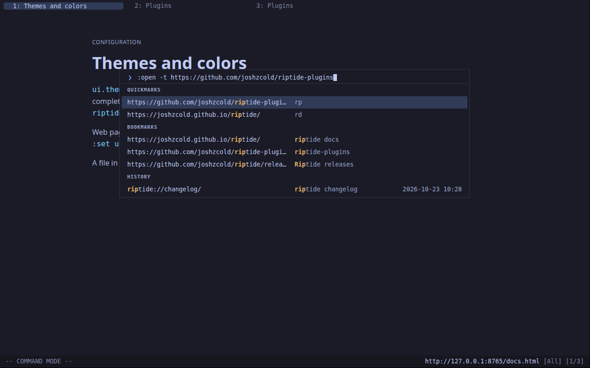
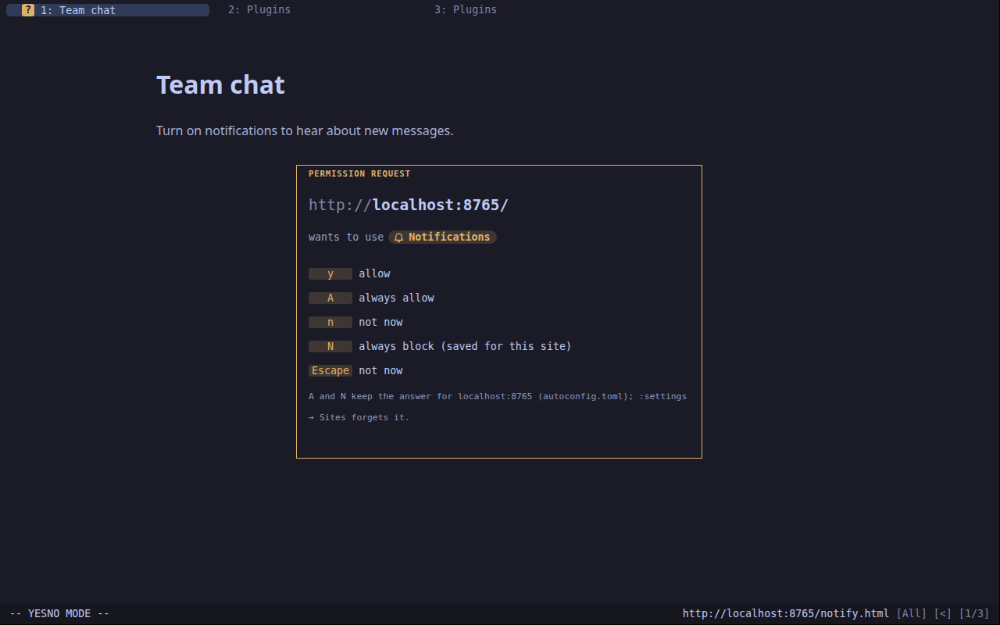
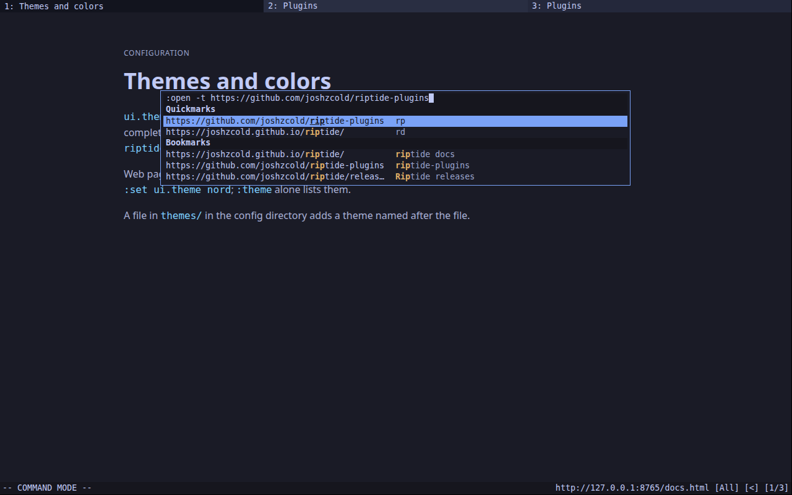

# noice

A cleaner look for riptide, in the spirit of
[noice.nvim](https://github.com/folke/noice.nvim): the command line becomes a
palette with its matches in groups, questions sit in a framed box in the
middle of the page, tabs are rounded and the status bar goes quiet. It's all
CSS on riptide's own bars, in your theme's colors, so `:theme` still works.





Without it, the same command line:



## Setup

The palette and the centered questions need two settings of your own; noice
only styles them, and never changes your settings:

```lua
c.ui.overlay.position = "floating"  -- the command line in a box near the top,
                                    -- or "center" for the middle (riptide after 0.8.0)
c.prompt.position = "center"        -- questions in the middle of the page

rt.pack.add({ "https://github.com/joshzcold/riptide-plugins", subdir = "noice", opts = {
  accent = "#7aa2f7",  -- the accent; the theme's selection color when unset
  cmdline = true,      -- the palette
  prompts = true,      -- the question box
  tabs = true,         -- rounded tabs
  statusbar = true,    -- the quiet status bar
} })
```

`:noice` turns the look off and back on.

It asks for the `ui` permission, since the status bar and the question box show
riptide's questions and CSS could disguise one. noice keeps the site that's
asking first and large, and changes only the frame, spacing and colors.

Your own `ui.css` comes after noice's, so a rule there overrides it.
